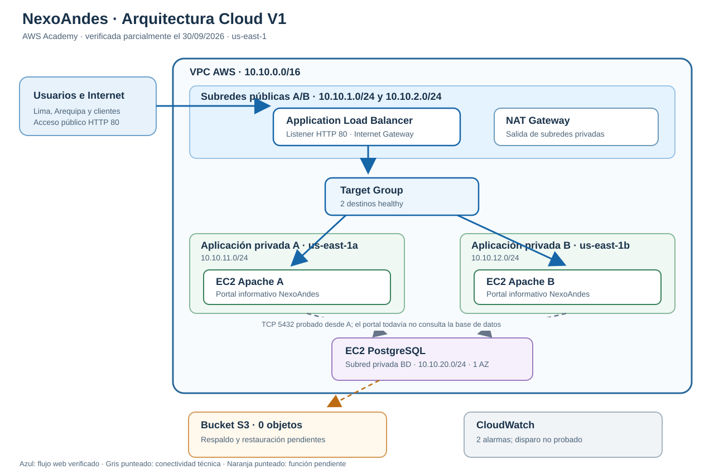

# Entregable 1 — Diseño e implementación inicial de la solución Cloud

**Universidad Peruana Unión · E.P. Ingeniería de Sistemas**  
**Cloud Computing · Proyecto Integrador · Arquitectura V1**

| Campo | Valor |
|---|---|
| Nombre del proyecto | Portal cloud de catálogo para NexoAndes (propuesta) |
| Empresa ficticia | NexoAndes Distribución S.A.C. (propuesta) |
| Integrantes y códigos | Por definir |
| Docente | Por definir |
| Fecha de entrega | Por definir |

## 01   Descripción de la empresa

NexoAndes Distribución S.A.C. es una empresa ficticia de distribución de suministros de oficina. El caso propone una oficina y almacén en Lima, un punto de atención en Arequipa, 45 trabajadores, 25 usuarios internos y unos 60 clientes empresariales. Son supuestos de dimensionamiento académico, no datos medidos de una empresa real.

La necesidad inicial es consultar un catálogo desde Internet sin depender de un único servidor en una sede. La V1 implementa el portal informativo y su infraestructura AWS. Los pedidos y el inventario transaccional no forman parte de la aplicación demostrada.

## 02   Problema identificado

El escenario inicial presenta dependencia de un servidor local, crecimiento manual de capacidad, ausencia de recuperación probada y poca separación entre acceso público y datos. Una falla del servidor o del enlace podría impedir la consulta del catálogo.

La primera respuesta es una arquitectura AWS con entrada balanceada, web en dos zonas y PostgreSQL privado. La integración Azure/GCP y Supabase pertenecen a la evolución V2 y se documentan en el segundo entregable.

## 03   Objetivo general

Diseñar e implementar una arquitectura inicial en AWS que publique el catálogo, distribuya la capa web entre dos zonas, separe las redes pública y privada y permita comprobar conectividad, persistencia y funcionamiento.

### Objetivos específicos

1. Definir requisitos y justificar proveedor, modelos y servicios.
2. Implementar VPC, subredes, ALB, servidores web y PostgreSQL privado.
3. Verificar el portal y la recuperación de un respaldo con evidencia fechada.
4. Identificar puntos únicos de falla y proponer mejoras para V2.

## 04   Requerimientos

| ID | Requisito de V1 | Verificación y alcance |
|---|---|---|
| RF01 | Publicar el catálogo por Internet | HTTP 200 comprobado en AWS; no se afirma una prueba desde ambas sedes físicas |
| RF02 | Dos servidores web en distintas zonas | ALB/ASG con capacidad deseada 2 y zonas us-east-1a/b |
| RF03 | PostgreSQL privado, accesible desde aplicación | SG por origen y conectividad técnica; el catálogo no ejecuta pedidos ni inventario |
| RF04 | Separar entrada pública, aplicaciones y datos | Cinco subredes, rutas y SG definidos |
| RF05 | Identificar empresa y equipo en la página | Reservar E05 con el número real del equipo; el marcador XX no acredita esta presentación |
| RNF01 | Recuperar la capa web ante pérdida de una instancia | Reposición por ASG; ensayos posteriores detallados en V2 |
| RNF02 | Evitar PostgreSQL público | Instancia sin IP pública y sin ingreso 5432 desde Internet |
| RNF03 | Permitir crecimiento web de 2 a 4 | Capacidad configurada en V1; prueba dinámica posterior corresponde a V2 |
| RNF04 | Conservar datos y recuperar un respaldo | EBS persistente; backup/restauración y ciclo de apagado/reencendido comprobados el 22/10 |
| RNF05 | Observar salud y errores del servicio | Métricas y alarmas CloudWatch; no equivale a notificaciones a un destinatario |

## 05   Modelo de servicio seleccionado

| Modelo | Aplicación en la V1 | Justificación |
|---|---|---|
| IaaS | EC2, VPC y EBS | El equipo administra sistema operativo, Apache y PostgreSQL |
| Servicios administrados | ALB, S3 y CloudWatch | El proveedor opera balanceo, objetos y métricas; el equipo configura su uso |
| PaaS de base de datos | No utilizado para PostgreSQL | La base corre en EC2; la restricción histórica de RDS se registra en INC-003 |
| SaaS académico | Incorporado posteriormente en V2 mediante Supabase | No se atribuye esa ampliación a la V1 |

El uso de servicios administrados no convierte PostgreSQL sobre EC2 en RDS.

## 06   Modelo de despliegue

La V1 utiliza nube pública AWS Academy en us-east-1. La evolución V2 distribuye funciones entre AWS principal, GCP contingencia y Azure respaldos. La V1 se evalúa como base AWS, conservando su diagrama y alcance separados de esa evolución.

## 07   Análisis preliminar de proveedores

| Necesidad | AWS | Azure | GCP | Decisión de V1 |
|---|---|---|---|---|
| Cómputo | EC2 | Virtual Machines | Compute Engine | EC2 y herramientas previas del laboratorio |
| Red | VPC y SG | VNet y NSG | VPC y Firewall Rules | VPC segmentada en dos zonas |
| Objetos | S3 | Blob Storage | Cloud Storage | S3 para los respaldos iniciales |
| Base relacional | PostgreSQL sobre EC2 o RDS | PostgreSQL sobre VM o servicio administrado | PostgreSQL sobre VM o Cloud SQL | PostgreSQL autogestionado por restricciones del entorno |
| Observabilidad | CloudWatch | Azure Monitor | Cloud Monitoring | CloudWatch disponible en la base AWS |

Esta comparación identifica alternativas; no supone que todos esos productos estén desplegados. AWS Academy usa sesiones y permisos temporales. Azure está sujeto a regiones autorizadas y GCP a créditos y capacidad reducida; sus implementaciones efectivas se describen en V2.

## 08   Proveedor seleccionado

Se seleccionó AWS Academy como proveedor principal por el entorno formativo disponible, el código de red/cómputo existente y la posibilidad de comprobar el portal, los respaldos y la persistencia. La cuenta de continuidad es 849533029543, us-east-1.

La primera etapa de septiembre/octubre correspondía a otra cuenta. El 22/10/2026 se recreó la base con Terraform en la cuenta de continuidad; los IDs de la etapa anterior no se presentan como recursos actuales.

## 09   Arquitectura Cloud V1



**Figura 1. Arquitectura Cloud V1.** Se conserva la figura de la primera fase: ALB, dos web en distintas zonas, PostgreSQL en subred privada, almacenamiento y monitoreo. El portal es informativo; la conexión con PostgreSQL corresponde a comprobaciones técnicas, no a un sistema comercial completo. La figura incluye el complemento HTTPS académico observado en esa fase; su validación actual y las ampliaciones posteriores se detallan en V2.

El ASG y el ALB ya forman parte de V1. La mejora posterior consiste en probar políticas dinámicas y recuperación, no en atribuir a V2 la creación de una capa que ya existía.

## 10   Servicios utilizados

| Servicio | Función en la base V1 | Evidencia |
|---|---|---|
| EC2 / Launch Template / ASG | Apache y reposición de web, capacidad 2–4 | Dos zonas; código y pruebas de la base recreada |
| VPC / subredes / IGW / NAT | Segmentación y salida de recursos privados | Rutas y cinco subredes |
| ALB / Target Group | Entrada web y destinos saludables | Respuesta HTTP 200 |
| PostgreSQL 15 sobre EC2 | Persistencia privada y prueba de conectividad | Consulta y respaldo/restauración |
| EBS / S3 | Datos persistentes y dumps | Ciclo de apagado/reencendido del 22/10 |
| IAM / SSM / SG | Perfil existente del laboratorio y administración de instancias | No se afirma una política IAM propia de mínimo privilegio |
| CloudWatch | Métricas y alarmas | La prueba dinámica del 04/11 se presenta como evolución V2 |

## 11   Diseño de red

### 11.1  Red virtual, direccionamiento y subredes

| Subred | CIDR | Zona | Función |
|---|---|---|---|
| public_a | 10.10.1.0/24 | us-east-1a | ALB y NAT |
| public_b | 10.10.2.0/24 | us-east-1b | ALB |
| app_a | 10.10.11.0/24 | us-east-1a | Web A |
| app_b | 10.10.12.0/24 | us-east-1b | Web B |
| db | 10.10.20.0/24 | us-east-1a | PostgreSQL |

### 11.2  Entrada / salida a Internet y enrutamiento

Internet llega al ALB por el Internet Gateway. Los servidores privados salen mediante un NAT; el endpoint Gateway de S3 permite acceso a objetos por la ruta privada configurada. PostgreSQL y las web no requieren IP pública.

### 11.3  Reglas de acceso y puertos utilizados

| Destino | Entrada | Origen | Alcance |
|---|---|---|---|
| ALB | TCP 80 | Internet | Portal inicial |
| ALB | TCP 443 | Internet, al habilitar TLS | Certificado académico, no confianza pública |
| Web | TCP 80 | SG del ALB | Tráfico balanceado |
| PostgreSQL | TCP 5432 | SG de aplicación | Acceso entre capas |
| Administración | SSM | Rol del laboratorio y agente | Sin ingreso SSH público en Terraform de continuidad |

La exposición SSH de los scripts históricos (INC-006) no describe la configuración Terraform de continuidad. Las reglas añadidas para GCP y Supabase se separan en V2.

### 11.4  Diagrama de red (opcional)

> **Espacio para la imagen de topología de red.** Insertar `evidencias/E01-topologia-red.png` cuando esté disponible y añadir pie de figura con fecha y origen.

## 12   Implementación inicial

La base se recreó el 22/10/2026 en AWS 849533029543 con Terraform. Se verificaron portal HTTP 200, respaldo/restauración y apagado/reencendido con datos conservados. La verificación histórica se registra en [evidencias de la base recreada](../../aws/evidencias/terraform-20261022/README.md).

El [inventario del 04/11 a las 23:01 Lima](../../infraestructura/evidencias/inventario-mapa-20261104.json) permite contrastar los componentes de base aún presentes, junto con ampliaciones V2. No se trasladan a V1 los resultados multicloud o de Supabase de ese día.

| Componente de base | Configuración | Evidencia para la presentación |
|---|---|---|
| Red | VPC 10.10.0.0/16 y cinco subredes | E01 |
| Web | ALB y ASG mínimo 2 / máximo 4, dos zonas | E02 |
| Datos | PostgreSQL privado y EBS de datos de 20 GB | E03 |
| Respaldo/monitoreo | S3 y CloudWatch | E04 |
| Portal | Catálogo por ALB | E05 |

Los IDs de instancias web y el DNS del ALB pueden cambiar al recrear recursos; cada captura debe indicar su fecha.

> **Espacio para foto de implementación:** `evidencias/E00-inventario-recursos.png`. Debe mostrar los recursos que realmente figuren como creados; tapar claves y tokens si aparecieran en pantalla.

## 13   Evidencias

Las capturas complementan las evidencias técnicas. Se conserva la reserva para que se incorporen las imágenes originales con fecha y servicio.

### Evidencia 01 — Red AWS

> **📷 FOTO PENDIENTE:** `evidencias/E01-red-aws.png`  
> Insertar aquí la captura de VPC, subredes y rutas que tomarás.

**Resultado a mostrar:** VPC, subredes, rutas y SG de la cuenta de continuidad.

### Evidencia 02 — Aplicación y balanceo

> **📷 FOTO PENDIENTE:** `evidencias/E02-alb-asg.png`  
> Insertar aquí la captura de ALB, Target Group y dos instancias saludables.

**Resultado a mostrar:** ALB y dos destinos saludables en zonas distintas.

### Evidencia 03 — Conectividad de base de datos

> **📷 FOTO PENDIENTE:** `evidencias/E03-postgresql.png`  
> Insertar aquí la captura de la prueba TCP desde la capa de aplicación y de la consulta local en PostgreSQL.

**Resultado a mostrar:** Consulta técnica PostgreSQL y reglas del puerto 5432.

### Evidencia 04 — Almacenamiento y monitoreo

> **📷 FOTO PENDIENTE:** `evidencias/E04-s3-cloudwatch.png`  
> Insertar aquí capturas del bucket y las alarmas; usar dos imágenes si no caben legiblemente en una.

**Resultado a mostrar:** Objeto de respaldo S3 y métricas/alarmas CloudWatch.

### Evidencia 05 — Página del proyecto

> **📷 FOTO PENDIENTE:** `evidencias/E05-portal-nexoandes.png`  
> Insertar aquí la captura del navegador con URL y «Proyecto Cloud – Equipo XX» visibles.

**Resultado a mostrar:** Portal con URL, empresa y número de equipo definitivo.

## 14   Prueba de funcionamiento

La comprobación de la base recreada del 22/10 obtuvo HTTP 200 y datos conservados después del ciclo de apagado/reencendido. Es una prueba del portal y de la persistencia; no acredita funcionalidades transaccionales de pedidos.

| Prueba | Resultado acreditado | Límite |
|---|---|---|
| Portal por ALB | HTTP 200 | La captura final debe mostrar la identificación del equipo |
| PostgreSQL | Conectividad y consulta técnica | Sin módulo de negocio sobre la BD |
| Backup y ciclo de vida | Restauración y persistencia comprobadas | No equivale a disponibilidad permanente |

> **📷 FOTO PRINCIPAL PENDIENTE:** `evidencias/E05-portal-nexoandes.png`. Reservar aquí la captura final del navegador; debe verse el texto exigido por la plantilla.

## 15   Escalabilidad preliminar

La capa web tiene ASG mínimo 2 y máximo 4. El ALB reparte las solicitudes y usa health checks; una instancia de reemplazo obtiene el portal desde la plantilla de lanzamiento.

En V1 se configura la capacidad y se analiza su crecimiento. La prueba posterior de aumento automático 2→4 por solicitudes se presenta en V2, sin atribuir a la base una validación de 5.000 usuarios. PostgreSQL sigue siendo una única instancia.

## 16   Seguridad inicial

| Control de base | Aplicación | Límite |
|---|---|---|
| Segmentación | Subredes públicas, web privadas y BD privada | Un NAT y una BD |
| SG | ALB → web → PostgreSQL | Los permisos de red no equivalen a permisos IAM |
| SSM / IMDSv2 | Administración mediante perfil existente | LabRole no es un rol personalizado por el equipo |
| Persistencia y cifrado | EBS cifrado; S3 con cifrado y versionado | Versionado no es inmutabilidad |
| Credenciales | Material operativo en carpetas privadas | La clave académica histórica conservada no debe compartirse |

HTTPS académico, identidad Supabase y pruebas adicionales de seguridad se documentan con su fecha en V2. No se afirma cumplimiento certificado de una norma.

## 17   Puntos únicos de falla — SPOF

| Componente | Falla posible | Consecuencia en V1 |
|---|---|---|
| PostgreSQL único | Pérdida de VM o volumen | Interrupción de acceso a datos; requiere recuperación |
| NAT único | Falla de salida privada | Dificulta bootstrap/actualizaciones y acceso a servicios externos |
| Una región/cuenta | Interrupción regional o de sesión Academy | El ASG no resuelve una caída de toda la región o del laboratorio |
| Web | Falla de una instancia | ALB/ASG reducen este punto único, sin resolver los anteriores |

La persistencia de un volumen no garantiza que sus datos sobrevivan a cualquier borrado o incidente.

## 18   Mejoras previstas para el Entregable 2

| Mejora V2 | Objetivo |
|---|---|
| Probar escalado por solicitudes y reposición | Verificar elasticidad y recuperación web |
| Réplica PG15 y portal mínimo en GCP | Ensayar contingencia y retorno manual |
| Copias verificadas en Azure/GCP | Disponer de respaldos fuera de AWS y probar restauración |
| Supabase y Studio autenticado | Incorporar identidad y servicio SaaS académico |
| Plan de seguridad y riesgos residuales | Relacionar amenazas, controles, evidencias y limitaciones |

Estas mejoras y sus pruebas se desarrollan en el segundo entregable.

## 19   Conclusiones

La V1 establece una base AWS segmentada y reproducible con ALB, web en dos zonas, PostgreSQL privado y respaldos. La recreación en la cuenta de continuidad permitió demostrar funcionamiento y conservación de datos.

La redundancia web no elimina las dependencias únicas de BD, NAT y laboratorio. La evolución V2 amplía recuperación e identidad sin presentar esas mejoras como disponibilidad automática integral.

## 20   Anexos

### A. Configuraciones

Terraform de la base en `aws/terraform/`; las ampliaciones actuales se distinguen en V2. Material de autenticación excluido del documento.

### B. Comandos utilizados

```bash
./nexoandes comprobar --nube aws
./nexoandes plan encender --nube aws
./nexoandes encender --nube aws
./nexoandes apagar --nube aws
```

> **📷 ESPACIO PARA FOTOS ADICIONALES:** `evidencias/anexo-*.png`. Añadir pie, fecha y relación con una prueba.

### C. Capturas adicionales

Se conservan los espacios E01–E05 y el diagrama original de V1.

### D. Enlaces

- [Evidencias de recreación de la base, 22/10/2026](../../aws/evidencias/terraform-20261022/README.md).
- [Diagrama V1](evidencias/arquitectura-v1.png).
- [Documentación AWS de ALB](https://docs.aws.amazon.com/elasticloadbalancing/latest/application/introduction.html).

### E. Otras evidencias

Las evidencias posteriores de escalabilidad, continuidad multicloud y Supabase pertenecen al Entregable 2. Una foto actual de la solución ampliada debe identificarse como tal, conservando la distinción V1/V2.
