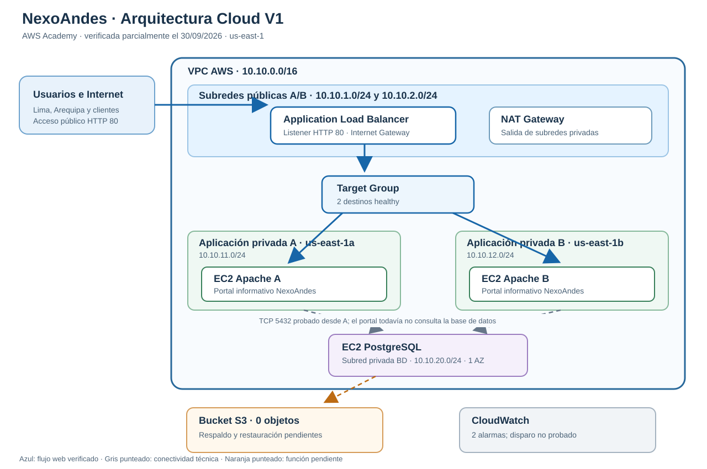
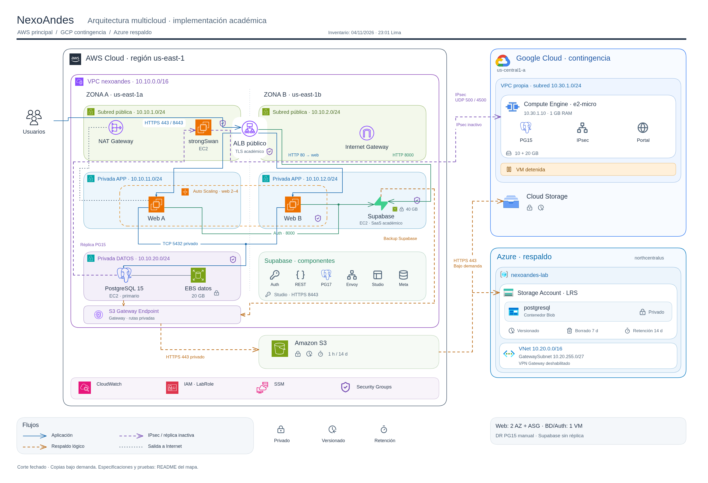

# UNIVERSIDAD PERUANA UNIÓN
### Facultad de Ingeniería y Arquitectura
### Escuela Profesional de Ingeniería de Sistemas

**CURSO: CLOUD COMPUTING · PROYECTO INTEGRADOR**

---

# Entregable 2
## Seguridad, optimización, escalabilidad y resiliencia de la solución  
### *Arquitectura V1 → Arquitectura V2*

| **NOMBRE DEL PROYECTO** | **Portal cloud de catálogo para NexoAndes** |
|---|---|
| **INTEGRANTES** | Vargas, Glender — 202310628 |
| **EQUIPO** | [Equipo XX] |
| **DOCENTE** | INGE ASCIN |
| **FECHA** | 05/11/2026 — actualización técnica |

**Lima, Perú**  
**2026**

---

## Contenido

- [02 Resumen del Entregable 1](#02---resumen-del-entregable-1)
- [03 Arquitectura V1](#03---arquitectura-v1)
- [04 Retroalimentación recibida](#04---retroalimentación-recibida)
- [05 Comparación V1 versus V2](#05---comparación-v1-versus-v2)
- [06 Arquitectura Cloud V2](#06---arquitectura-cloud-v2)
- [07 Seguridad](#07---seguridad)
- [08 Análisis de amenazas y vulnerabilidades](#08---análisis-de-amenazas-y-vulnerabilidades)
- [09 IAM](#09---iam)
- [10 Seguridad de red](#10---seguridad-de-red)
  - [10.1 Subredes](#101--subredes)
  - [10.2 Reglas de entrada y salida / puertos permitidos](#102--reglas-de-entrada-y-salida--puertos-permitidos)
  - [10.3 Servicios expuestos](#103--servicios-expuestos)
- [11 Escalabilidad](#11---escalabilidad)
- [12 Alta disponibilidad y tolerancia a fallos](#12---alta-disponibilidad-y-tolerancia-a-fallos)
- [13 Eliminación de SPOF](#13---eliminación-de-spof)
- [14 Monitoreo](#14---monitoreo)
- [15 Backup y recuperación](#15---backup-y-recuperación)
- [16 Pruebas realizadas](#16---pruebas-realizadas)
- [17 Evidencias](#17---evidencias)
- [18 Costos preliminares](#18---costos-preliminares)
- [19 Riesgos residuales](#19---riesgos-residuales)
- [20 Conclusiones técnicas](#20---conclusiones-técnicas)

---

### 02   Resumen del Entregable 1

El Entregable 1 presentado por el estudiante, fechado el 01/10/2026, documenta la verificación AWS del 30/09/2026: portal de catálogo HTTP con ALB, ASG de dos web en zonas distintas, PostgreSQL privado y CloudWatch. El bucket S3 estaba vacío, el disparo de las alarmas no se había probado y el crecimiento, la reposición y la recuperación seguían por demostrar. SSH público y secretos en scripts se reconocían como riesgos. La V1 no incorporaba autenticación ni transacciones comerciales.

Azure y OCI aparecían como diseño previsto, sin despliegues o túneles probados. La base AWS se recreó el 22/10 en la cuenta actual 849533029543; GCP sustituyó a OCI el 28/10. La V2 incorpora continuidad PG15 AWS–GCP, copias privadas Azure/GCP, pruebas de crecimiento y recuperación, e identidad/backend con Supabase.

El alcance sigue siendo portal informativo, autenticación y demostración técnica de datos; no incluye pedidos, inventario ni una aplicación comercial completa. El inventario general corresponde al 04/11, Studio externo se probó a las 23:33 de ese día e IAM básico se verificó el 05/11.

### 03   Arquitectura V1

**Figura 1. Detalle AWS de la V1 presentada.** Imagen conservada byte a byte desde la Figura 2 del Entregable 1 recibido. Representa el estado del 30/09: S3 vacío y alarmas sin prueba de disparo. El diseño multicloud inicial contemplaba Azure/OCI; GCP pertenece a la evolución posterior.

### 04   Retroalimentación recibida

Las siguientes acciones proceden del diagnóstico técnico y las pruebas; no se atribuyen comentarios al docente sin un registro de retroalimentación.

| Hallazgo de V1 | Acción V2 | Límite conservado |
|---|---|---|
| ASG configurado, sin validación de crecimiento por demanda | Prueba automática 2→4 por solicitudes | No acredita 5.000 usuarios ni escala-in automático |
| PostgreSQL único | Réplica física PG15 en GCP, promoción y retorno ensayados | Operación manual; no incluye Supabase |
| S3 vacío y recuperación sin probar | Copias privadas Azure/GCP, hashes y restauraciones | Versionado no es inmutabilidad; copia operativa bajo demanda |
| Seguridad con evidencias insuficientes | Prueba de bloqueo de origen no autorizado, SSM, SG y TLS académico | LabRole heredado y tráfico interno HTTP |
| Portal sin identidad | Auth Supabase, endpoint protegido y Studio autenticado HTTPS 8443 | Sin HA de identidad ni lógica comercial completa |

### 05   Comparación V1 versus V2

| Aspecto | V1 | V2 y mejora demostrada |
|---|---|---|
| Cómputo | Web A/B y PG15 en EC2 | Mantiene esa base; agrega EC2 privada Supabase y VM GCP de contingencia |
| Red | Cinco subredes AWS | IPsec strongSwan AWS–GCP; Azure conserva VNet sin VPN Gateway activo |
| Seguridad | Segmentación y SG | Prueba negativa de acceso, Auth/endpoint de identidad y HTTPS del portal/panel |
| Escalabilidad | ASG mínimo 2 / máximo 4 | Crecimiento 2→4 observado por solicitudes; ensayo CPU limitado por créditos |
| Disponibilidad | Redundancia web | Recuperación PG15 en GCP ensayada; cambio de URL y promoción manuales |
| Monitoreo | CloudWatch | Políticas por CPU/solicitudes y alarmas con acciones de escalado; sin panel multicloud consolidado |
| Backup | S3 y persistencia EBS | Copias Azure/GCP con igualdad SHA256 y restauración SQL; backup Supabase separado |

### 06   Arquitectura Cloud V2

**Figura 2. Arquitectura V2, corte documentado del 04/11/2026.** AWS aloja el portal y Supabase; GCP contiene una VM con PG15 standby, strongSwan y portal alternativo; Azure conserva copias independientes en Blob. El mapa incluye puertos, zonas y Security Groups.

| Nube | Componentes implementados | Estado registrado y limitación |
|---|---|---|
| AWS us-east-1 | ALB, ASG 2–4, PG15, Supabase privado, EBS, S3 y gateway EC2 strongSwan | AWS activo; PostgreSQL y Supabase con datos independientes |
| GCP us-central1-a | e2-micro 1 GB RAM; subred 10.30.1.0/24, discos 10 + 20 GB, PG15 standby y portal mínimo; Cloud Storage | VM detenida en el último inventario; la réplica y el portal no están activos al detenerla |
| Azure northcentralus | Grupo nexoandes-lab, StorageV2 LRS, contenedor postgresql, VNet 10.20.0.0/16 | Almacenamiento desplegado; VPN Gateway/Log Analytics deshabilitados |

La VPC GCP es global y no tiene un CIDR único; el CIDR corresponde a su subred. Las copias de objetos usan HTTPS; solo la réplica PG15 usa IPsec. Las herramientas de desarrollo no son servidores del servicio.

Supabase se presenta como nuestro **SaaS académico** de autenticación y backend. Técnicamente es una plataforma BaaS/PaaS open source autohospedada sobre IaaS EC2. Auth/REST usan HTTPS 443 del ALB; Studio utiliza HTTPS 8443 con credenciales administrativas distintas de las del usuario de aplicación.

### 07   Seguridad

| Dimensión | Control y herramienta aplicados | Evidencia o límite |
|---|---|---|
| Identidad | LabRole/LabInstanceProfile, sesión Azure y cuenta de servicio GCP existentes | No se afirma creación de usuarios, grupos o roles personalizados |
| Autenticación | Supabase Auth y Basic Auth del dashboard Studio | Login, rechazo sin token y rechazo de credenciales erróneas probados |
| Autorización | Backend consulta Auth para validar el usuario; separación usuario/admin | Endpoint de identidad propio; no hay tablas comerciales ni RLS comercial implementada |
| Mínimo privilegio | SG por origen y puertos; claves administrativas fuera del frontend | Auditoría básica de IAM del 05/11: LabRole, RBAC de datos Azure y permisos Storage GCP; mínimo privilegio integral fuera de lo demostrado |
| Firewall | SG AWS y firewall GCP; puertos UDP 500/4500 acotados al peer | No se incorpora NSG Azure ni WAF como si estuvieran desplegados |
| Segmentación | Web, PG15 y Supabase sin IP pública | ALB publica el portal/panel; no se abre PostgreSQL a Internet |
| Cifrado | EBS y objetos cifrados, IPsec, HTTPS público con certificado académico | ALB→backend y tráfico interno HTTP; portal GCP HTTP; sin cifrado integral extremo a extremo |
| Respaldo | Dumps horarios AWS, S3 versionado y copias Azure/GCP | Retención configurada 14 días; copia entre nubes requiere ejecución operativa |
| Registros | IDs SSM, resultados de pruebas y operaciones Terraform | No hay auditoría centralizada multicloud implementada |
| Monitoreo | CloudWatch: métricas, alarmas y políticas de escalado | Sin alarmas propias de memoria/disco ni destinatario SNS configurado |

#### 7.1 Plan integral de seguridad

**Objetivo y alcance:** proteger portal, identidades, PG15, red, credenciales y respaldos durante las demostraciones. El equipo opera las nubes; usuarios de aplicación y administrador de Studio tienen funciones distintas. Los datos de prueba son sintéticos.

**Operación:** antes de cada sesión se comprueba identidad, estado y fechas de evidencia; se revisa el plan antes de aplicar. Los secretos permanecen fuera de entregables. Ante pérdida de credenciales se revocan/renuevan las sesiones y claves afectadas; ante falla de datos se aísla el primario antes de promover o restaurar. Las incidencias y resultados quedan registrados. Al cerrar se detiene el cómputo preservando datos y copias.

**Referencia de controles:** se utiliza [NIST CSF 2.0](https://www.nist.gov/cyberframework) como marco de organización, no como certificación ni declaración de cumplimiento integral.

| Función de referencia | Aplicación en el proyecto | Brecha reconocida |
|---|---|---|
| Govern | Alcance académico, responsables y restricciones de créditos documentados | Saldo y vencimiento requieren verificación del titular |
| Identify | Inventario, diagrama y matriz de riesgos | Actualizar el inventario IAM fechado e incluir servicios nuevos en cada revisión |
| Protect | SG, segmentación, cifrado y separación de credenciales | Certificado público, TLS interno y mínimo privilegio IAM integral no demostrados |
| Detect | CloudWatch y comprobaciones de salud | Sin alertas a personas ni correlación centralizada de logs |
| Respond | Procedimientos de aislamiento, cambio de claves e incidencias | Administración GCP independiente de AWS aún no probada |
| Recover | Restauraciones PG15, promoción y retorno ensayados | Restauración integral y contingencia de Supabase pendientes |

### 08   Análisis de amenazas y vulnerabilidades

La matriz usa STRIDE para identificar escenarios; no supone que se hayan ejecutado ataques reales de cada tipo.

| Activo / amenaza | Vulnerabilidad e impacto | Control aplicado | Riesgo residual |
|---|---|---|---|
| Credenciales / suplantación | Robo de sesión o contraseña permite actuar como usuario/admin | Secretos privados, tokens breves, Auth y dashboard autenticado | MFA de consolas no auditado; Studio usa credencial administrativa |
| Datos / alteración | Un operador comprometido podría alterar una BD o dump | SG, acceso administrativo separado, SHA256 y restauración | Hash/versionado no impiden un borrado autorizado malicioso |
| Operaciones / repudio | Ausencia de trazabilidad consolidada dificulta atribuir acciones | IDs SSM, operaciones Terraform y evidencias fechadas | Sin auditoría central multicloud verificada |
| Red / divulgación | Interceptación o acceso indebido expone información | Segmentación, IPsec y HTTPS externo | HTTP interno y portal GCP HTTP; TLS académico no confiable públicamente |
| Web / denegación de servicio | Carga superior a CPU/memoria o cuota produce indisponibilidad | ALB, dos zonas y ASG por solicitudes | T3 Standard, cuatro web máximas y sin capacidad de 5.000 usuarios validada |
| IAM / elevación de privilegios | Rol amplio puede aumentar el alcance de una intrusión | IMDSv2 y no inclusión de claves administrativas en frontend | LabRole y permisos cloud heredados no equivalen a mínimo privilegio integral |

### 09   IAM

| Tipo / identidad real | Uso observado | Políticas y privilegios acreditados |
|---|---|---|
| AWS LabRole / LabInstanceProfile | Instancias administradas por SSM y bootstrap autorizado | Cinco EC2 usan el perfil y exigen IMDSv2; siete políticas adjuntas y cero inline exportadas. AmazonSSMManagedInstanceCore habilita SSM; STS y acceso S3 probados desde el host Supabase |
| Sesión AWS voclabs/STS | Operaciones CLI/Terraform en cuenta 849533029543 | Cuenta y región verificadas; sesión temporal |
| Usuario Microsoft Entra / Azure CLI | Operaciones y copia de respaldos | Owner heredado en la suscripción; Storage Blob Data Contributor creado por Terraform, limitado al contenedor postgresql. La copia usa --auth-mode login, sin consultar claves de la cuenta |
| Cuenta de servicio GCP existente | Compute, red y Storage del proyecto gen-lang-client-0623826791 | Permisos Storage get/list/create/delete comprobados con la cuenta de servicio y política del bucket exportada; lectura de roles globales no disponible porque Cloud Resource Manager API está deshabilitada |
| Supabase usuario de demostración / dashboard admin | Acceso al portal y administración de Studio, respectivamente | Identidades de aplicación separadas; no sustituyen a IAM de la nube |

##### Aplicación del mínimo privilegio

Se restringe el tráfico de entrada y se separan claves públicas de secretos administrativos. IMDSv2 es obligatorio. En Supabase solo el host usa LabRole; los contenedores no requieren credenciales AWS.

El control IAM básico usa identidades reales y permisos comprobables. LabRole es un rol precreado y amplio de AWS Academy; no se alteraron sus políticas o confianza. Azure incorpora una asignación propia de acceso a datos al contenedor de respaldo, conservando el Owner administrativo existente. GCP usa la cuenta de servicio existente y conserva sus permisos heredados. Esto no acredita mínimo privilegio integral ni MFA de consolas. Evidencia: [auditoría IAM del 05/11](../../integracion/IAM.md).

### 10   Seguridad de red

#### 10.1  Subredes

| Nube / subred | CIDR | Zona / región | Recursos |
|---|---|---|---|
| AWS public_a | 10.10.1.0/24 | us-east-1a | ALB, NAT y EC2 strongSwan |
| AWS public_b | 10.10.2.0/24 | us-east-1b | ALB |
| AWS app_a | 10.10.11.0/24 | us-east-1a | Web A |
| AWS app_b | 10.10.12.0/24 | us-east-1b | Web B y EC2 Supabase |
| AWS db | 10.10.20.0/24 | us-east-1a | PG15 y EBS de datos 20 GB |
| GCP subred | 10.30.1.0/24 | us-central1 / VM en -a | PG15 standby, IPsec y portal en una VM |
| Azure GatewaySubnet | 10.20.255.0/27, en VNet 10.20.0.0/16 | northcentralus | Subred creada; gateway deshabilitado |

#### 10.2  Reglas de entrada y salida / puertos permitidos

| Destino | Entrada | Origen autorizado | Propósito |
|---|---|---|---|
| ALB | TCP 80, 443 | Internet | Portal; Auth/REST exige HTTPS |
| ALB Studio | TCP 8443 | Internet | Dashboard con Basic Auth y TLS académico |
| Web | TCP 80 | SG ALB | Portal y backend |
| PG15 | TCP 5432 | SG web y CIDR GCP por ruta IPsec | Acceso privado y réplica |
| Supabase Envoy | TCP 8000 | SG ALB y SG web | API/panel detrás del balanceador |
| AWS/GCP strongSwan | UDP 500/4500 | IP del peer acotada /32 | IPsec |
| GCP SSH | TCP 22 | Orígenes administrativos/gateway autorizados | Administración restringida |

Las salidas AWS de aplicación, BD, Supabase y gateway permiten tráfico mediante sus rutas; no se presentan como una política de egreso mínimo integral. Las web y datos usan NAT; S3 tiene endpoint Gateway. SSM evita abrir SSH en AWS.

#### 10.3  Servicios expuestos

| Servicio | Entrada pública | Control |
|---|---|---|
| Portal | ALB 80/443 | Health checks y web privadas |
| Auth/REST | ALB 443 | Claves/tokens; HTTP 403 y registro libre deshabilitado |
| Studio | ALB 8443 | Dashboard user/password; sin credenciales 401; /pg y MCP externos 403 |
| Portal GCP | HTTP 80 cuando la VM está activa | URL alternativa manual; sin TLS público probado |

La BD y postgres-meta no tienen una entrada pública directa. El acceso al panel no publica el puerto PostgreSQL.

### 11   Escalabilidad

La política de demostración utiliza ALBRequestCountPerTarget con objetivo de 30 solicitudes por destino/minuto. El ensayo observó crecimiento automático 2→4 y 2.137 HTTP 200, sin errores observados en esa muestra. Las cuatro instancias estaban InService a los 391,7 s. El retorno a dos fue solicitado manualmente.

| Usuarios concurrentes planteados por la plantilla | Análisis de respuesta, no resultado medido |
|---|---|
| 100 | Medir latencia, errores, CPU y acceso a Auth antes de asignar una capacidad garantizada |
| 500 | Revisar saturación de web, BD y Supabase; permitir al ASG responder dentro de 2–4 |
| 1.000 | Validar cuotas y límites de T3/BD; no se conoce una equivalencia usuarios→CPU por falta de ensayo de concurrencia |
| 5.000 | Requiere redimensionamiento y prueba específica; fuera de la capacidad validada del laboratorio |

La política CPU existe, pero el ensayo de CPU se limitó por créditos T3 Standard y no acredita escalado exitoso por esa vía. Contar solicitudes HTTP no es contar usuarios concurrentes.

### 12   Alta disponibilidad y tolerancia a fallos

| Falla | Comportamiento probado o previsto |
|---|---|
| Una web | Reposición y dos destinos saludables en 229,79 s; 183 HTTP 200 sin errores observados |
| Aplicación | ALB detecta salud del destino; la recuperación de un defecto común de software no fue probada |
| PG15 primario | Promoción manual GCP tras aislar AWS; 7,87 s hasta BD disponible y 24,66 s hasta reconexión de la sonda de aplicación |
| Portal AWS | En el ensayo sin web/BD AWS, AWS dio 502 y portal GCP dio 200 mediante otra URL |
| Supabase | Stop/start conservó usuario y volumen; no hay segunda instancia ni contingencia Auth en GCP |
| Proveedor/plano de administración | No se simuló caída completa del proveedor; la administración GCP ensayada depende del gateway AWS |

Los tiempos corresponden a datos sintéticos y a un ensayo, no a un SLA. Las pruebas de web y de autenticación se realizaron por separado; no demuestran continuidad integral del SaaS ante cualquier falla.

### 13   Eliminación de SPOF

| SPOF | Mejora V2 | Situación residual |
|---|---|---|
| Una web | Dos zonas y ASG con reposición probada | Un cambio defectuoso común puede afectar ambas |
| PG15 único | Réplica GCP y restauraciones verificadas | Promoción/retorno manuales; réplica detenida no se actualiza |
| Backup en una nube | Copias Azure/GCP | Transferencia bajo demanda y sin inmutabilidad |
| Identidad Supabase | Disco propio y backup | Una VM y base de identidad sin réplica; falta restauración integral |
| NAT/gateway/laboratorio | Procedimientos reproducibles y copias externas | Siguen siendo dependencias únicas; el apagado interrumpe servicio |

Se reducen algunos puntos únicos de falla, no se eliminan todos.

### 14   Monitoreo

| Recurso / métrica | Umbral o configuración | Acción real |
|---|---|---|
| ASG / CPUUtilization | Target Tracking CPU 50% | Escalado configurado; ensayo CPU limitado por créditos |
| ALB-ASG / solicitudes por destino | Objetivo 30 por minuto, de demostración | Crecimiento automático 2→4 probado |
| ALB / HTTPCode_Target_5XX_Count | Suma >5 en 60 s; nexoandes-http5xx | Estado observable, sin destinatario de notificación |
| ASG / CPU alta operativa | Promedio >80%, dos períodos de 300 s | Alarma nexoandes-cpu-alta; sin acción de notificación |
| Web / salud ALB | Health check HTTP / | ALB retira destino no saludable; ASG repone |
| Memoria/disco/Supabase | Sin alarmas propias desplegadas | Verificación operativa puntual; ampliación pendiente |

CloudWatch registra métricas y alarmas AWS. No se declara Azure Monitor/Log Analytics ampliado ni Cloud Monitoring centralizado como implementados. Una alarma sin acción SNS no equivale a avisar a una persona.

### 15   Backup y recuperación

| Elemento | Periodicidad / ubicación | Retención y recuperación |
|---|---|---|
| PG15 | Dump horario en AWS mientras está activo; S3; copias operativas a Azure/GCP | Ciclo de vida 14 días; dumps externos restaurados con siete filas sintéticas verificadas |
| Supabase | Archivo propio con bases, roles y configuración; timer horario en su VM; S3 y copias Azure/GCP | S3 prefijo supabase 14 días; restauración selectiva auth.users verificada, no de la pila completa |
| Réplica PG15 | Streaming por IPsec cuando ambos extremos están activos | Permite promoción; no sustituye un backup ni incluye PG17/Auth |
| Discos | EBS PG15 20 GB; Supabase 40 GB; GCP datos 20 GB y arranque 10 GB | Persistencia al detener; no se afirma snapshot automático |

El RPO de un dump depende de la antigüedad de la última copia recuperable. Con transferencias externas bajo demanda no se garantiza RPO de una hora; la réplica asíncrona también depende de su atraso y de que esté activa. Los tiempos del ensayo son resultados observados, no objetivos de RTO/RPO garantizados.

Los hashes de las copias descargadas coincidieron. Azure tiene borrado lógico de 7 días y ciclo de vida de 14 días; versionado/ciclo de vida no son WORM. Las copias entre nubes se coordinan con herramientas de desarrollo por HTTPS; el timer local está deshabilitado por la pausa solicitada. La laptop no participa en el tráfico de usuarios.

##### Procedimiento de recuperación

1. Identificar el incidente y aislar el primario para evitar dos escritores.
2. Elegir el dump y registrar su origen/fecha; verificar SHA256 tras descargarlo.
3. Restaurar PG15 en una BD aislada, comprobar consulta y filas y luego definir el cambio de conexión. En contingencia de réplica, promover solo tras comprobar su estado y aislamiento.
4. Validar la sonda y, si se usa el portal GCP, cambiar manualmente a su URL. La autenticación Supabase no se recupera mediante la réplica PG15.
5. Realizar retorno controlado y reconciliar la réplica; conservar evidencias de consistencia.

Para Supabase, la validación realizada se limita a auth.users en BD temporal. La restauración integral de claves, servicios y usuarios aún debe ensayarse antes de declarar recuperable toda la plataforma.

### 16   Pruebas realizadas

| Prueba | Resultado obtenido | Evidencia |
|---|---|---|
| Acceso web/datos | HTTP 200 en AWS/GCP durante el ensayo y consulta sintética | [sondas](../../integracion/evidencias/20261104/sondas-iniciales.json) |
| Seguridad | Origen no autorizado a PG15 bloqueado; consulta autorizada comprobada | [seguridad](../../integracion/evidencias/20261104/seguridad.json) |
| Falla web | Reposición 229,79 s; 183 HTTP 200 | [fallo-web](../../integracion/evidencias/20261104/fallo-web.json) |
| Escalabilidad | 2→4 automático; 2.137 HTTP 200 | [escalabilidad](../../integracion/evidencias/20261104/escalabilidad.json) |
| Recuperación PG15 | Promoción, portal alternativo y retorno; cinco filas originales preservadas | [failover](../../integracion/evidencias/20261104/failover.json), [consistencia](../../integracion/evidencias/20261104/consistencia-retorno.json) |
| Restauración de copias | Azure/GCP restaurados en BDs temporales AWS: siete filas; ID máximo 39 no equivale a 39 filas | [restauracion-ciclo](../../integracion/evidencias/20261104/restauracion-ciclo.json) |
| Auth Supabase | Login 200; sin token/inventado 401; logout 204; token anterior 401 | [Auth](../../integracion/evidencias/20261104/supabase/pruebas-auth.json) |
| Persistencia y web nueva | Mismo usuario/disco tras reinicio; Auth instalado en reemplazo ASG en 197,1 s | [persistencia](../../integracion/evidencias/20261104/supabase/persistencia-reinicio.json), [bootstrap](../../integracion/evidencias/20261104/supabase/arranque-web-asg.json) |
| Restauración Supabase | auth.users coincide en cantidad/checksum, alcance selectivo | [restauracion-auth](../../integracion/evidencias/20261104/supabase/restauracion-auth.json) |
| Studio externo | Sin/incorrectas 401; autorizado 200; meta/MCP 403; navegador sin errores JS | [HTTP](../../integracion/evidencias/20261104/supabase/studio-externo.json), [navegador](../../integracion/evidencias/20261104/supabase/studio-navegador.json) |

Todas son evidencias fechadas del 04/11/2026, horario Lima. No acreditan que un servicio permanezca encendido después del ensayo.

### 17   Evidencias

#### Mejora 01 — Política de escalado probada sobre el ASG existente

**Antes:** ASG 2–4 ya formaba parte de V1, sin prueba de crecimiento por solicitudes. **Después:** se observó 2→4 mediante Target Tracking. **Resultado:** 2.137 HTTP 200 y cuatro instancias InService en el ensayo.

*(Espacio reservado para Captura de Consola AWS: Target Group mostrando 2 destinos healthy en distintas zonas y configuración del ASG)*

#### Mejora 02 — Evidencia de seguridad y acceso privado

**Antes:** la base V1 ya estaba segmentada; los scripts históricos registraban exposiciones que no deben confundirse con Terraform actual. **Después:** bloqueo de origen no autorizado, acceso por SSM, reglas privadas y peer GCP acotado. **Resultado:** PG15 sin puerto público.

*(Espacio reservado para Captura de Consola AWS: Tabla de subredes privadas y reglas de entrada del Security Group `sg-db`)*

#### Mejora 03 — Copias externas y recuperación

**Antes:** respaldo inicial en S3. **Después:** copias privadas/versionadas en Azure/GCP, SHA256 coincidente y restauraciones SQL. **Resultado:** integridad y recuperación de datos sintéticos; no inmutabilidad.

*(Espacio reservado para Captura de Consola Azure Portal: Contenedor `postgresql` en Storage Account mostrando los blobs `.dump` y terminal con hashes SHA256 coincidentes)*

#### Mejora 04 — Métrica de solicitudes y crecimiento real

**Antes:** métricas/alarma CPU en V1. **Después:** escalado por solicitudes probado; CPU limitada por créditos no se presenta como prueba exitosa. **Resultado:** crecimiento automático por ALBRequestCountPerTarget.

*(Espacio reservado para Captura de Consola CloudWatch: RequestCountPerTarget y actividad de escalado; la captura de CPU se identifica como ensayo limitado, no como causa del escalado exitoso)*

#### Mejora 05 — Réplica y contingencia PG15

**Antes:** PG15 único. **Después:** standby GCP, promoción y retorno manuales comprobados. **Resultado:** consistencia de datos en los ensayos.

> **📷 FOTO PENDIENTE:** `evidencias/V2-E05-gcp-replica.png`. Mostrar VM/discos y evidencia de réplica/recuperación con fecha; una VM detenida no acredita réplica activa.

#### Mejora 06 — Identidad y SaaS académico Supabase

**Antes:** portal sin autenticación. **Después:** Auth, endpoint privado y Studio externo por HTTPS 8443. **Resultado:** 401 sin credenciales y 200 autorizado; PostgreSQL permanece privado.

> **📷 FOTO PENDIENTE:** `evidencias/V2-E06-supabase.png`. Mostrar portal autenticado y Studio sin revelar tokens, contraseñas ni claves API.

### 18   Costos preliminares

Estimación preliminar de referencia, no factura ni saldo de créditos. Se usan dos escenarios hipotéticos AWS: 20 horas activas de demostración al mes y 730 horas continuas. El inventario incluye cuatro t3.micro (dos web, PG15 y gateway), una t3.medium Supabase, 80 GB EBS persistentes y 24 GB temporales.

| Componente AWS | 20 h/mes (USD) | 730 h/mes (USD) |
|---|---:|---:|
| EC2: 4 t3.micro | 0.83 | 30.37 |
| EC2: 1 t3.medium (Supabase) | 0.84 | 30.51 |
| ALB: cargo horario | 0.45 | 16.43 |
| ALB: supuesto 1 LCU/h | 0.16 | 5.84 |
| NAT: cargo horario | 0.90 | 32.85 |
| IPv4: supuesto 4 direcciones | 0.40 | 14.60 |
| EBS persistente: 80 GB todo el mes | 6.40 | 6.40 |
| EBS temporal: 24 GB prorrateados | 0.05 | 1.92 |
| **Subtotal AWS de componentes modelados** | **10.03** | **138.92** |

Tarifas consultadas el 04/11/2026: [EC2 T3](https://aws.amazon.com/ec2/instance-types/t3/), [ALB](https://aws.amazon.com/elasticloadbalancing/pricing/), [NAT/IPv4](https://aws.amazon.com/vpc/pricing/) y [EBS](https://aws.amazon.com/ebs/pricing/). Se toma t3.medium a 0,0418 USD/h de la tabla T3 publicada; gp3 a 0,08 USD/GB-mes como hipótesis del ejemplo público, y NAT a 0,045 USD/h del ejemplo público de Ohio, pendiente de cotización exacta en us-east-1. Se supone 1 LCU/h y un mínimo ilustrativo de cuatro IPv4. No son mediciones de uso. Las filas se redondean individualmente; el subtotal se calcula antes del redondeo.

**No es un total multicloud:** faltan S3, CloudWatch, NAT por GB, transferencias, impuestos, Azure Blob y recursos GCP. Para completarlo, Azure requiere GB/versiones y operaciones Hot LRS en northcentralus; GCP requiere horas e2-micro, 30 GB pd-standard, objetos y red en us-central1. Fuentes: [Azure Blob](https://azure.microsoft.com/en-us/pricing/details/storage/blobs/), [discos GCP](https://cloud.google.com/compute/disks-image-pricing) y [Cloud Storage](https://cloud.google.com/storage/pricing).

La estimación muestra el impacto de mantener cómputo/red encendidos frente a sesiones cortas; el almacenamiento persistente continúa. El presupuesto GCP declarado es US$10/mes, con saldo/vencimiento no verificados. No se asume Free Tier aplicable ni costo cero. El cálculo reproducible y sus exclusiones se conservan en [estimacion.json](../costos/estimacion.json).

### 19   Riesgos residuales

| Riesgo | Probabilidad / impacto | Tratamiento y límite |
|---|---|---|
| BD/Auth en una sola VM cada una | Media / Alta | Réplica PG15 y backups; restauración integral y contingencia Supabase pendientes |
| GCP detenido o sin capacidad suficiente | Alta durante pausa / Alta | Encender/reconciliar antes de la demostración; 1 GB RAM no es capacidad de producción |
| Caducidad de sesión/créditos | Alta / Alta | Sesiones controladas y cierre con datos conservados; saldos por verificar |
| NAT o gateway únicos | Media / Alta | Recuperación mediante código; sin redundancia de esos componentes |
| Copias dependientes de ejecución operativa | Media / Alta | Verificar antigüedad y hashes; sin copia autónoma ni WORM |
| Robo de credenciales / rol amplio | Media / Alta | Separación usuario/admin e IAM básico verificado; LabRole y administración heredada amplios; MFA de consolas no verificado |
| TLS académico, HTTP interno/GCP | Media / Alta | Datos sintéticos y acceso acotado; certificado público y TLS completo son mejoras pendientes |
| Falta de alerta a personas | Media / Media | Revisión operativa; destinatario y notificaciones no configurados |

La probabilidad es una valoración cualitativa del ejercicio, no una frecuencia medida. No se declara certificación ISO ni cumplimiento legal auditado.

### 20   Conclusiones técnicas

#### ¿Qué mejoró entre V1 y V2?

Se probó el crecimiento web por solicitudes y la reposición de instancias, se incorporó recuperación PG15 en GCP y se verificaron copias/restauraciones fuera de AWS. Supabase aporta identidad y backend académico, con Studio externo autenticado. El diseño y las pruebas distinguen recursos implementados, estados de apagado y límites de cada nube.

#### ¿Qué queda pendiente para el producto final?

La restauración integral y contingencia de Supabase, la auditoría detallada de permisos, el monitoreo de memoria/disco y las alertas a personas, la administración GCP independiente y la transferencia autónoma de copias requieren trabajo adicional. El failover DNS automático, TLS de confianza pública y la eliminación de todos los componentes únicos no están implementados. Pedidos/inventario y RLS comercial quedan fuera del prototipo demostrado.

La documentación conserva las reservas para las capturas finales; los ensayos existentes no se presentan como pruebas pendientes ni se usan para prometer capacidad no medida.
