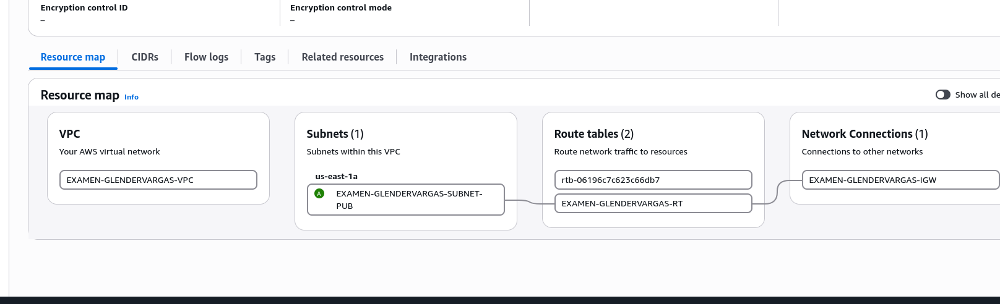
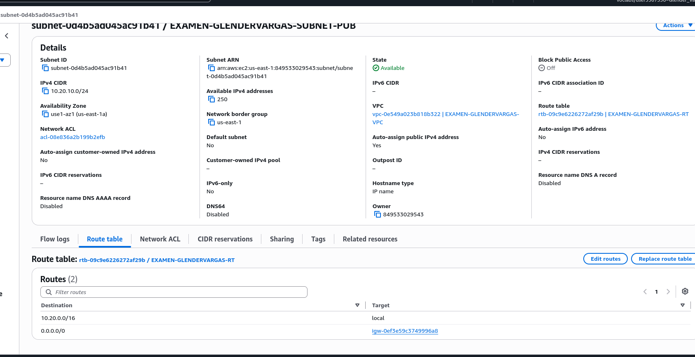
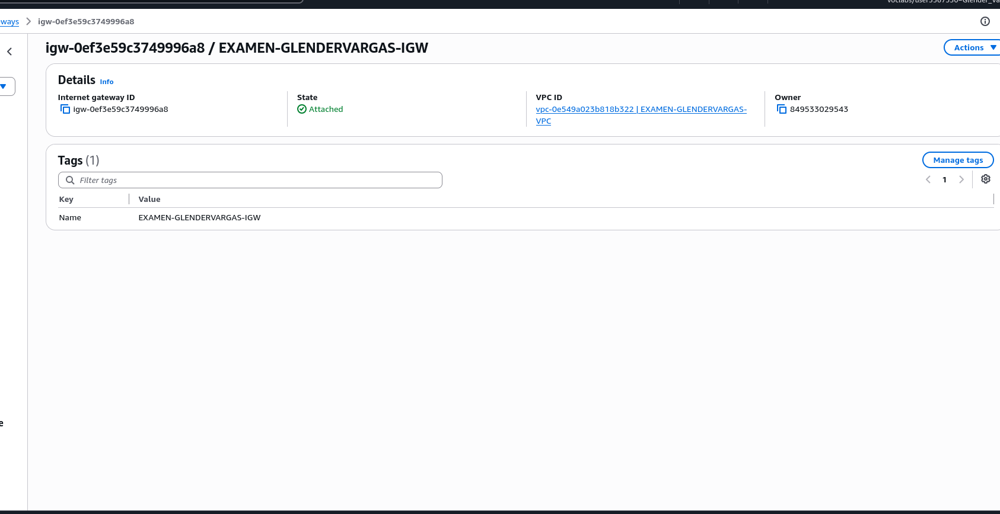
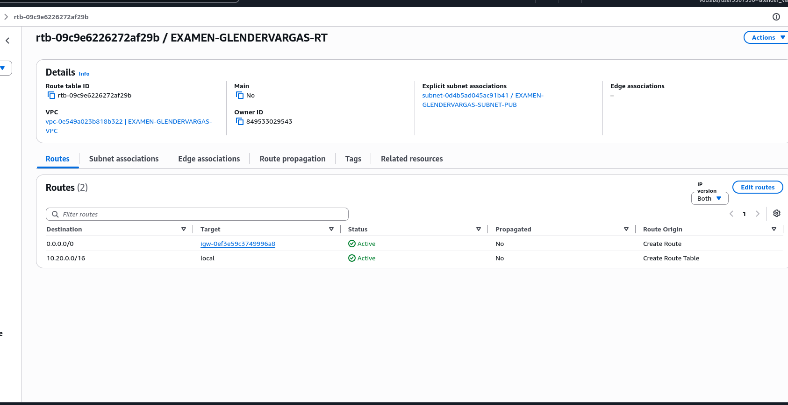
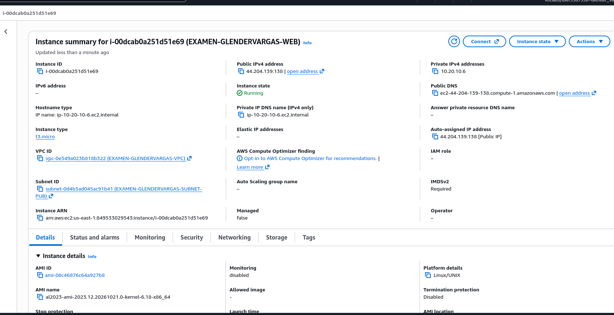
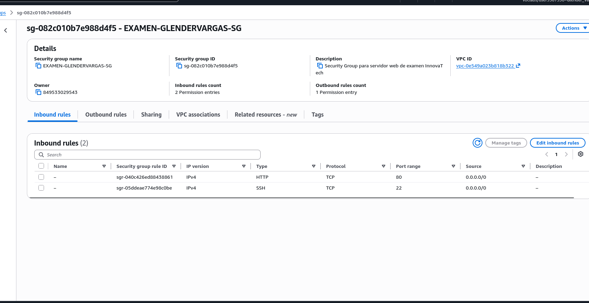
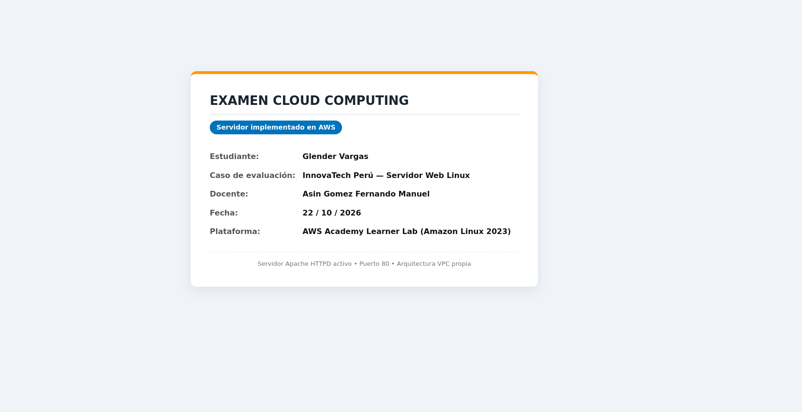
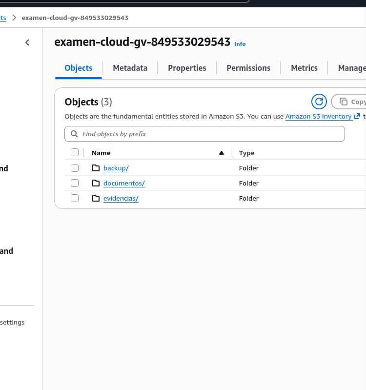
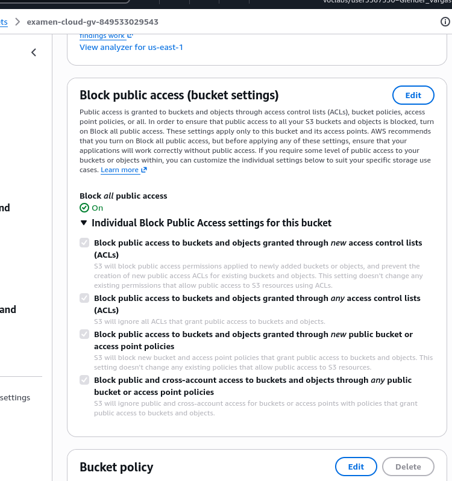
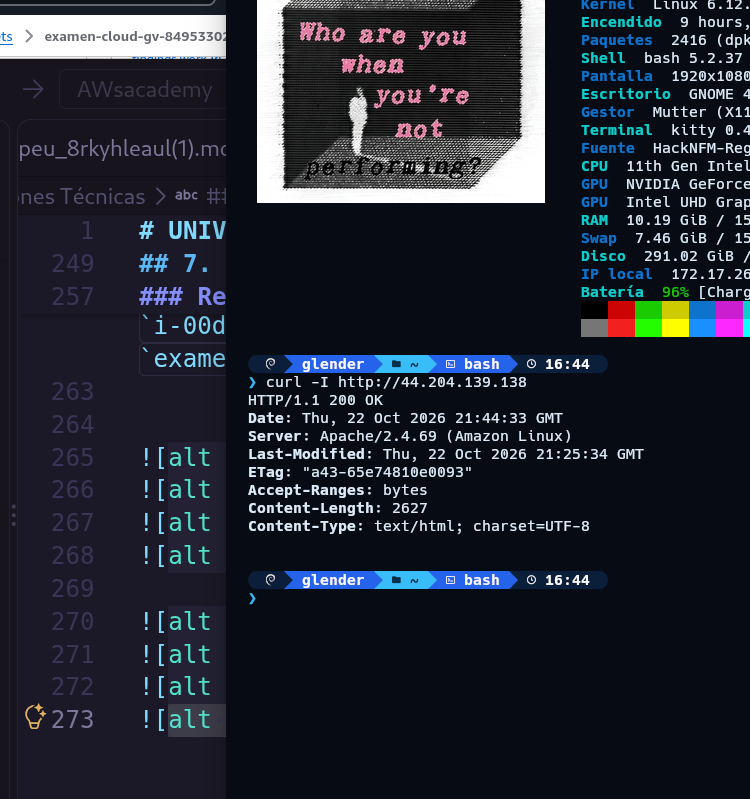

# UNIVERSIDAD PERUANA UNIÓN
### Facultad de Ingeniería y Arquitectura · Escuela Profesional de Ingeniería de Sistemas
**CURSO: CLOUD COMPUTING — PROYECTO INTEGRADOR**  
**EXAMEN PRÁCTICO INTEGRADOR — CONTENIDOS HASTA LA SEMANA 7**

---

| Campo | Detalle |
| :--- | :--- |
| **ESTUDIANTE** | Glender Vargas |
| **CÓDIGO** | [Completar código de estudiante] |
| **DOCENTE** | Asin Gomez Fernando Manuel |
| **FECHA** | 22 / 10 / 2026 |
| **PLATAFORMA** | AWS Academy Learner Lab |
| **CASO DE EVALUACIÓN** | InnovaTech Perú — Servidor Web Seguro y Almacenamiento de Objetos |
| **PUNTAJE** | ____ / 20 |

---

## 1. Diseño de Arquitectura

### 1.1 Diagrama de la Solución Implementada
La arquitectura diseñada e implementada para la empresa InnovaTech Perú responde al requerimiento de publicar un servidor web Linux en alta velocidad y seguridad en la nube de AWS, desacoplando los archivos y respaldos en almacenamiento de objetos Amazon S3.

```
+---------------------------------------------------------------------------------------------------+
| AWS Cloud (Región us-east-1)                                                                      |
|                                                                                                   |
|   +-------------------------------------------------------------------------------------------+   |
|   | VPC: EXAMEN-GLENDERVARGAS-VPC (CIDR: 10.20.0.0/16)                                        |   |
|   |                                                                                           |   |
|   |   Internet Gateway: EXAMEN-GLENDERVARGAS-IGW (igw-0ef3e59c3749996a8)                      |   |
|   |          ▲                                                                                |   |
|   |          │ Ruta por defecto 0.0.0.0/0                                                     |   |
|   |   Tabla de Rutas: EXAMEN-GLENDERVARGAS-RT (rtb-09c9e6226272af29b)                         |   |
|   |          │                                                                                |   |
|   |          ▼                                                                                |   |
|   |   +-----------------------------------------------------------------------------------+   |   |
|   |   | Subnet Pública: EXAMEN-GLENDERVARGAS-SUBNET-PUB (10.20.10.0/24 - us-east-1a)      |   |   |
|   |   | [Auto-assign Public IPv4: Enabled]                                                |   |   |
|   |   |                                                                                   |   |   |
|   |   |   +---------------------------------------------------------------------------+   |   |   |
|   |   |   | Security Group: EXAMEN-GLENDERVARGAS-SG (sg-082c010b7e988d4f5)            |   |   |   |
|   |   |   |   - Inbound: HTTP (80/TCP)  0.0.0.0/0 (Acceso Web Público)                |   |   |   |
|   |   |   |   - Inbound: SSH  (22/TCP)  0.0.0.0/0 (Administración Remota)              |   |   |   |
|   |   |   |   - Outbound: All Traffic   0.0.0.0/0 (Actualizaciones dnf / repositorios) |   |   |   |
|   |   |   |                                                                           |   |   |   |
|   |   |   |   +-------------------------------------------------------------------+   |   |   |   |
|   |   |   |   | Instancia EC2: EXAMEN-GLENDERVARGAS-WEB (i-00dcab0a251d51e69)     |   |   |   |   |
|   |   |   |   | Tipo: t3.micro | SO: Amazon Linux 2023 (AL2023 x86_64)            |   |   |   |   |
|   |   |   |   | IP Privada: 10.20.10.6                                            |   |   |   |   |
|   |   |   |   | IP Pública: 44.204.139.138                                        |   |   |   |   |
|   |   |   |   | Servicio: Apache HTTPD 2.4.69 (Puerto 80 ACTIVO)                  |   |   |   |   |
|   |   |   |   |                                                                   |   |   |   |   |
|   |   |   |   |   +-----------------------------------------------------------+   |   |   |   |   |
|   |   |   |   |   | Volumen Raíz EBS (gp3 - 8 GiB)                            |   |   |   |   |   |
|   |   |   |   |   | EXAMEN-GLENDERVARGAS-WEB-ROOT (vol-010041d8e6ba04a8b)     |   |   |   |   |   |
|   |   |   |   |   +-----------------------------------------------------------+   |   |   |   |   |
|   |   |   |   +-------------------------------------------------------------------+   |   |   |   |
|   |   |   +---------------------------------------------------------------------------+   |   |   |
|   |   +-----------------------------------------------------------------------------------+   |   |
|   +-------------------------------------------------------------------------------------------+   |
|                                                                                                   |
|   +-------------------------------------------------------------------------------------------+   |
|   | Almacenamiento de Objetos: Amazon S3                                                      |   |
|   | Bucket: examen-cloud-gv-849533029543                                                      |   |
|   | Block Public Access: ACTIVADO (4/4 reglas de protección)                                  |   |
|   | Prefijos: /documentos/, /evidencias/, /backup/                                            |   |
|   +-------------------------------------------------------------------------------------------+   |
+---------------------------------------------------------------------------------------------------+
       ▲                                                           ▲
       │ Tráfico Web HTTP (Puerto 80)                              │ Gestión de Objetos
       │                                                           │
+--------------+                                            +--------------+
|   Internet   | ◄───────────────────────────────────────── |   Usuario    |
+--------------+                                            +--------------+
```

### 1.2 Preguntas Técnicas de Arquitectura

#### 1. ¿Por qué la instancia EC2 necesita una dirección IP pública para este escenario?
En esta arquitectura básica de publicación web directa (sin un balanceador de carga público interpuesto), la instancia EC2 reside en una subred pública y debe interactuar directamente con clientes externos a través de Internet. La dirección IPv4 pública (mapeada 1:1 por el Internet Gateway hacia la IP privada de la interfaz mediante Network Address Translation) es indispensable para que los paquetes enrutados desde Internet alcancen el servidor y la pila TCP/IP pueda responder a las solicitudes HTTP entrantes en el puerto 80.

#### 2. ¿Cuál es la diferencia entre almacenar archivos del servidor en EBS y almacenarlos en S3?
* **Amazon Elastic Block Store (EBS):** Es almacenamiento a nivel de bloques (*block storage*) de alto rendimiento y baja latencia, diseñado para actuar como el disco duro local (volumen raíz o adicional) de una instancia EC2 dentro de una misma Zona de Disponibilidad. Requiere un sistema de archivos tradicional (XFS/ext4) y está fuertemente acoplado al ciclo de vida de la máquina virtual.
* **Amazon Simple Storage Service (S3):** Es almacenamiento de objetos (*object storage*) distribuido y desacoplado, accesible mediante peticiones REST/HTTP/API desde cualquier punto de la red. Ofrece una durabilidad del 99.999999999% (11 nueves) con redundancia nativa en múltiples Zonas de Disponibilidad, ideal para resguardo de documentos, copias de seguridad estáticas y assets multimedia sin consumir espacio de disco de la máquina virtual.

#### 3. Clasificación de los recursos implementados
* **Cómputo:** Instancia Amazon EC2 (`EXAMEN-GLENDERVARGAS-WEB`, `t3.micro`, Amazon Linux 2023).
* **Red:** Amazon Virtual Private Cloud (`EXAMEN-GLENDERVARGAS-VPC`, `10.20.0.0/16`), Subred Pública (`EXAMEN-GLENDERVARGAS-SUBNET-PUB`, `10.20.10.0/24`), Internet Gateway (`EXAMEN-GLENDERVARGAS-IGW`), Tabla de Enrutamiento (`EXAMEN-GLENDERVARGAS-RT`), Asignación de IPv4 pública.
* **Almacenamiento:** Volumen en bloque Amazon EBS (`EXAMEN-GLENDERVARGAS-WEB-ROOT`, `vol-010041d8e6ba04a8b`), Bucket de almacenamiento de objetos Amazon S3 (`examen-cloud-gv-849533029543`).
* **Seguridad:** Security Group (`EXAMEN-GLENDERVARGAS-SG`), Reglas de firewall de entrada (HTTP:80, SSH:22), Bloqueo de Acceso Público S3 (*Block Public Access* integral), Par de llaves SSH (`vockey`).

---

## 2. Implementación de Red AWS

### 2.1 Resumen Técnico de Recursos de Red
Se configuró una topología de red dedicada para el examen, garantizando aislamiento total respecto a la VPC por defecto y cualquier otra arquitectura previa:

| Recurso | Nombre / Tag | Identificador AWS | Configuración / CIDR | Estado |
| :--- | :--- | :--- | :--- | :---: |
| **VPC** | `EXAMEN-GLENDERVARGAS-VPC` | `vpc-0e549a023b818b322` | `10.20.0.0/16` | Disponible |
| **Subnet Pública** | `EXAMEN-GLENDERVARGAS-SUBNET-PUB` | `subnet-0d4b5ad045ac91b41` | `10.20.10.0/24` (AZ us-east-1a) | Disponible (Auto-assign IP: Sí) |
| **Internet Gateway** | `EXAMEN-GLENDERVARGAS-IGW` | `igw-0ef3e59c3749996a8` | Adjunto a `vpc-0e549a023b818b322` | Attached |
| **Route Table** | `EXAMEN-GLENDERVARGAS-RT` | `rtb-09c9e6226272af29b` | Ruta `0.0.0.0/0` -> `igw-0ef3e59c3749996a8` | Asociada a subnet |

### 2.2 Evidencias y Explicación
* **Creación de VPC y Subred:** Se definió el rango CIDR `10.20.0.0/16` con resolución de nombres DNS habilitada. La subred `10.20.10.0/24` fue creada en la zona `us-east-1a` configurando el atributo `MapPublicIpOnLaunch=true` para garantizar la asignación automática de IP pública a las instancias.
* **Internet Gateway y Enrutamiento:** El IGW fue acoplado a la VPC y enlazado en la tabla de rutas personalizada mediante una ruta destino `0.0.0.0/0`, permitiendo el tráfico bidireccional con Internet.

> **[INSERTAR CAPTURA 1: VPC y CIDR]**  
> *Descripción:* Consola de VPC mostrando `EXAMEN-GLENDERVARGAS-VPC` con el CIDR `10.20.0.0/16` y estado Available.

> **[INSERTAR CAPTURA 2: Subnet pública y asignación de IPv4]**  
> *Descripción:* Subred `EXAMEN-GLENDERVARGAS-SUBNET-PUB` con IPv4 CIDR `10.20.10.0/24` y el campo "Auto-assign public IPv4 address" en "Yes".

> **[INSERTAR CAPTURA 3: Internet Gateway adjunto a la VPC]**  
> *Descripción:* Internet Gateway `EXAMEN-GLENDERVARGAS-IGW` en estado "Attached" a la VPC `vpc-0e549a023b818b322`.

> **[INSERTAR CAPTURA 4: Tabla de rutas con destino 0.0.0.0/0 hacia IGW]**  
> *Descripción:* Pestaña "Routes" de `EXAMEN-GLENDERVARGAS-RT` mostrando la ruta `0.0.0.0/0` apuntando a `igw-0ef3e59c3749996a8` y la asociación a la subred pública.

---

## 3. Servidor EC2 y Publicación Web

### 3.1 Datos del Servidor Implementado
* **Nombre de Instancia:** `EXAMEN-GLENDERVARGAS-WEB`
* **Instance ID:** `i-00dcab0a251d51e69`
* **Tipo:** `t3.micro` (2 vCPU, 1 GiB RAM)
* **Sistema Operativo:** Amazon Linux 2023 AMI (`ami-08c46876c64a927b8`)
* **Dirección IPv4 Pública:** `44.204.139.138`
* **Dirección IPv4 Privada:** `10.20.10.6`
* **Security Group:** `EXAMEN-GLENDERVARGAS-SG` (`sg-082c010b7e988d4f5`)
* **Reglas de Entrada (Inbound Rules):**
  - **HTTP (Puerto 80, TCP, 0.0.0.0/0):** Permite el tráfico web de los clientes e inspectores hacia el servidor Apache.
  - **SSH (Puerto 22, TCP, 0.0.0.0/0):** Permite la administración remota de la instancia y verificación mediante consola.
* **Reglas de Salida (Outbound Rules):** Todo el tráfico (`All traffic`, `0.0.0.0/0`) para permitir descargas de repositorios `dnf`.

### 3.2 Despliegue de Apache y Publicación
Durante el aprovisionamiento de la instancia se ejecutó la automatización de inicio con los comandos estipulados:
```bash
sudo dnf install httpd -y
sudo systemctl enable httpd
sudo systemctl start httpd
sudo systemctl status httpd
```
El archivo `/var/www/html/index.html` fue desplegado exitosamente con la información requerida:
- Título principal: **EXAMEN CLOUD COMPUTING**
- Nombre completo del estudiante: **Glender Vargas**
- Texto requerido: **Servidor implementado en AWS**
- Fecha de la evaluación: **22 / 10 / 2026**
- Caso institucional: **InnovaTech Perú — Servidor Web Linux**

> **[INSERTAR CAPTURA 5: Instancia EC2 en estado Running con IP Pública]**  
> *Descripción:* Consola de EC2 mostrando la instancia `EXAMEN-GLENDERVARGAS-WEB` en estado "Running", con tipo `t3.micro` y la IPv4 pública `44.204.139.138`.

> **[INSERTAR CAPTURA 6: Security Group con reglas Inbound (HTTP 80 y SSH 22)]**  
> *Descripción:* Pestaña "Inbound rules" de `EXAMEN-GLENDERVARGAS-SG` mostrando la autorización de los puertos 80 y 22.

> **[INSERTAR CAPTURA 7: Servicio httpd activo y página index.html desde navegador]**  
> *Descripción:* Navegador web accediendo a `http://44.204.139.138` mostrando la tarjeta de examen con el nombre Glender Vargas, fecha y validación en AWS.

---

## 4. Amazon S3 y Seguridad

### 4.1 Configuración del Bucket
* **Nombre de Bucket:** `examen-cloud-gv-849533029543`
* **Región:** `us-east-1`
* **Bloqueo de Acceso Público (*Block Public Access*):** 100% Habilitado.
  - `BlockPublicAcls`: **True**
  - `IgnorePublicAcls`: **True**
  - `BlockPublicPolicy`: **True**
  - `RestrictPublicBuckets`: **True**

### 4.2 Estructura de Objetos Cargados
Se estructuraron los tres prefijos requeridos y se subieron los siguientes archivos de negocio para InnovaTech Perú:
1. `s3://examen-cloud-gv-849533029543/documentos/politica_seguridad_innovatech.txt`
2. `s3://examen-cloud-gv-849533029543/evidencias/evidencia_despliegue_arquitectura.txt`
3. `s3://examen-cloud-gv-849533029543/backup/respaldo_configuracion_web.txt`

### 4.3 Preguntas Técnicas de S3 y Seguridad

#### 4. ¿Por qué no es una buena práctica hacer público todo el bucket para compartir un solo archivo?
Hacer público todo el bucket vulnera el principio de mínimo privilegio (*least privilege*), exponiendo inadvertidamente todos los objetos actuales y futuros que se almacenen allí, lo que genera riesgos severos de exfiltración de información sensible, alteración indebida de archivos y sobrecostos por peticiones maliciosas no deseadas. Para compartir un único archivo deben utilizarse mecanismos granulares y temporales como URLs prefirmadas (*pre-signed URLs*) con tiempo de expiración definido o políticas de acceso específicas a nivel de objeto, manteniendo la barrera general de seguridad del bucket intacta.

#### 5. Si EC2 necesitara acceso permanente al bucket, ¿conviene almacenar Access Key/Secret Key en el servidor o utilizar un IAM Role? Justifique.
Conviene enfáticamente utilizar un **IAM Role** asociado a la instancia mediante un *Instance Profile*. Almacenar claves fijas (`Access Key` y `Secret Key`) en archivos de configuración o variables de entorno del servidor representa un grave riesgo de seguridad si la máquina virtual es vulnerada o si las credenciales se filtran accidentalmente, además de exigir una compleja rotación manual. Por el contrario, un IAM Role entrega credenciales criptográficas temporales que AWS renueva automáticamente de forma transparente mediante el servicio de metadatos (IMDS), eliminando por completo la existencia de secretos estáticos en el servidor.

> **[INSERTAR CAPTURA 8: Bucket S3 y estructura de carpetas / prefijos]**  
> *Descripción:* Vista del bucket `examen-cloud-gv-849533029543` mostrando los prefijos `backup/`, `documentos/` y `evidencias/` con sus respectivos archivos.

> **[INSERTAR CAPTURA 9: Configuración de Bloqueo de Acceso Público (Block Public Access)]**  
> *Descripción:* Pestaña "Permissions" del bucket evidenciando "Block all public access" en estado **On**.

---

## 5. Validación y Diagnóstico

### 5.1 Pruebas de Conectividad y Funcionamiento
1. **Validación Local en Servidor (curl localhost):**
   ```bash
   curl -I http://localhost
   # Respuesta: HTTP/1.1 200 OK - Apache/2.4.69 (Amazon Linux)
   ```
2. **Validación Remota desde Internet:**
   ```bash
   curl -I http://44.204.139.138
   # Respuesta: HTTP/1.1 200 OK
   # Server: Apache/2.4.69 (Amazon Linux)
   # Content-Type: text/html; charset=UTF-8
   ```
3. **Comprobación de Integridad:** Se confirmó que el servidor web retorna el código HTTP 200 y el cuerpo HTML renderiza adecuadamente todos los datos requeridos por la evaluación.

### 5.2 Pregunta Técnica de Diagnóstico

#### 6. Si EC2 está Running pero la página no abre desde Internet, indique cuatro elementos concretos de AWS/Linux que revisaría para diagnosticar el problema:
1. **Security Group (Inbound Rules):** Comprobar que exista una regla de entrada que autorice el protocolo TCP en el puerto 80 (HTTP) proveniente del origen deseado (`0.0.0.0/0`).
2. **Tabla de Enrutamiento e Internet Gateway:** Verificar que la subred donde reside la instancia esté asociada a una Route Table con una ruta activa hacia `0.0.0.0/0` que apunte al Internet Gateway (`igw-xxxx`).
3. **Estado del Daemon HTTPD en el Sistema Operativo:** Comprobar mediante conexión SSH o Systems Manager que el servicio Apache esté iniciado y escuchando activamente en el puerto 80 (`sudo systemctl status httpd` y `ss -tulpn | grep :80`).
4. **Asignación de Dirección IPv4 Pública:** Validar que la interfaz de red de la instancia posea asignada efectivamente una dirección IP pública de Internet y no se encuentre operando únicamente con direccionamiento privado.

> **[INSERTAR CAPTURA 10: Validación técnica con curl o consola de comandos]**  
> *Descripción:* Terminal mostrando la respuesta exitosa `HTTP/1.1 200 OK` del servidor web mediante curl a la IP pública `44.204.139.138`.

---

## 6. Análisis Profesional

*(Respuestas con un límite máximo de 6 líneas por fundamentación técnica)*

#### 7. La empresa desea migrar posteriormente una base de datos local. Explique dos riesgos que deberían evaluarse antes de la migración.
Primero, el tiempo de inactividad (*downtime*) y la consistencia transaccional durante el corte (*cutover*), ya que una sincronización deficiente puede corromper datos o interrumpir ventas. Segundo, la seguridad y latencia del enlace de red; alojar la base de datos sin una subred privada aislada o con una conexión inestable hacia la sede física degrada el rendimiento de las consultas y expone información confidencial a accesos no autorizados.

#### 8. Explique qué responsabilidad corresponde a AWS y cuál al cliente respecto a la seguridad de la instancia EC2.
Bajo el Modelo de Responsabilidad Compartida, AWS es responsable de la «seguridad **de** la nube»: salvaguardar la infraestructura física de los data centers, hardware del servidor, red troncal y el software del hipervisor. El cliente es responsable de la «seguridad **en** la nube»: aplicar parches y actualizaciones al sistema operativo (Amazon Linux), configurar el firewall (Security Groups), asegurar el servicio web (Apache) y proteger las claves SSH.

#### 9. Si el servidor recibe miles de solicitudes simultáneas, ¿qué limitación presenta la arquitectura implementada?
Constituye un punto único de falla (SPOF) con capacidad de procesamiento fija. Al tratarse de una única máquina `t3.micro` en una sola Zona de Disponibilidad, los recursos de CPU, memoria y ancho de banda se saturarán rápidamente bajo alta concurrencia, agotando la cola de conexiones de Apache y provocando denegación de servicio (caída total o latencia excesiva) sin capacidad de recuperación automática ante fallas.

#### 10. Proponga dos mejoras para aumentar disponibilidad, seguridad o escalabilidad.
1. **Alta Disponibilidad y Escalabilidad Horizontal:** Implementar un Application Load Balancer (ALB) público al frente de un Auto Scaling Group (ASG) con instancias distribuidas en al menos dos Zonas de Disponibilidad (Multi-AZ), permitiendo absorber picos de tráfico automáticamente.
2. **Seguridad y Protección Perimetral:** Reubicar las instancias EC2 en subredes privadas dejando únicamente el ALB en la subred pública, e integrar AWS WAF junto con certificados SSL/TLS (HTTPS en puerto 443) para mitigar ataques web comunes (DDoS, SQLi, XSS) y cifrar el tráfico.

---

## 7. Conclusiones Técnicas

1. **Aislamiento y control mediante redes virtuales personalizadas:** La creación de una VPC propia (`10.20.0.0/16`) con subredes y tablas de enrutamiento específicas demuestra que no se debe depender de la VPC por defecto en entornos de producción, ya que una VPC personalizada permite definir perímetros de red estrictos, segmentación por capas y control granular del flujo de tráfico hacia Internet mediante Internet Gateways y Security Groups.
2. **Desacoplamiento arquitectónico entre cómputo y almacenamiento:** Separar los archivos del servidor web (EBS para el sistema operativo y Amazon S3 para almacenamiento de objetos) incrementa notablemente la resiliencia de la empresa InnovaTech Perú, asegurando una durabilidad de datos del 99.999999999% en S3 y previniendo la pérdida de activos críticos ante la degradación o terminación de instancias de cómputo.
3. **Seguridad por diseño mediante defensa en profundidad:** La combinación de Security Groups con políticas de mínimo privilegio (puertos 80 y 22 únicamente), la activación irrestricta de *Block Public Access* en Amazon S3 y el principio de uso de IAM Roles en lugar de credenciales estáticas establecen una postura de seguridad robusta, alineada con las mejores prácticas del AWS Well-Architected Framework.

---

### Resumen de Recursos para Destrucción al Finalizar el Examen
Cuando el docente dé la indicación de concluir la evaluación y limpiar el entorno, se puede ejecutar el script automatizado que destruye únicamente los recursos de este examen sin afectar otros proyectos:
```bash
./examen/destruir-examen.sh
```
* Recursos creados: VPC `vpc-0e549a023b818b322`, Subnet `subnet-0d4b5ad045ac91b41`, IGW `igw-0ef3e59c3749996a8`, Route Table `rtb-09c9e6226272af29b`, Security Group `sg-082c010b7e988d4f5`, Instancia EC2 `i-00dcab0a251d51e69`, Bucket S3 `examen-cloud-gv-849533029543`.












